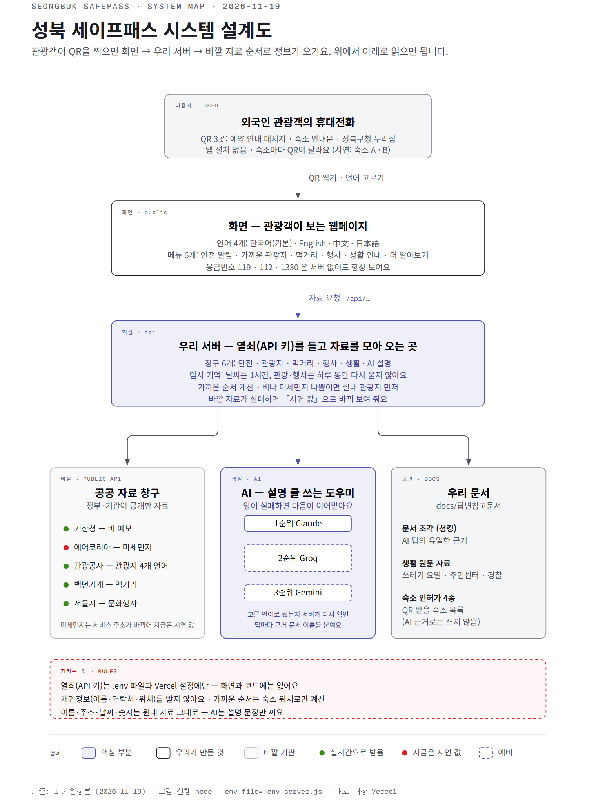

# 성북 세이프패스 (Seongbuk SafePass)

성북구 숙소에 머무는 **단기 외국인 관광객**이 숙소에 붙은 **QR코드 하나**로 아래 정보를 자기 언어로 보는 웹페이지입니다. 앱을 설치하지 않아도 됩니다.

- 오늘의 미세먼지 · 비 예보
- 숙소에서 가까운 관광지와 먹거리
- 진행 중이거나 예정된 행사
- 생활 안내 (쓰레기 배출 요일 · 주민센터 · 경찰 · 교통)

> 공공행정 캡스톤 디자인 [7] 3팀 시제품입니다.

## 주요 기능

| 기능 | 설명 |
|---|---|
| 4개 언어 | 한국어(기본) · English · 中文 · 日本語 |
| 오늘의 안전 알림 | 미세먼지 · 비 예보를 서버가 정한 **고정 문장**으로 알려요. 응급번호 119 · 112 · 1330은 항상 보여요 |
| 가까운 관광지 | QR 숙소에서 가까운 순서로 보여 줘요. 비가 오거나 미세먼지가 나쁘면 **실내 관광지를 먼저** 보여 줘요 |
| AI 설명 | 「오늘 가기 좋은 이유」를 AI가 쓰고, 답마다 **근거 문서 이름**을 붙여요 |
| 먹거리 · 행사 · 생활 안내 | 이름 · 주소 · 날짜는 공공데이터 **원문 그대로** 보여 줘요 |
| 실패해도 멈추지 않음 | 바깥 자료를 못 받으면 「시연 값」 표시와 함께 예시 자료를 보여 줘요 |

## 시스템 설계도



인쇄용 원본: [docs/시스템설계도.pdf](docs/시스템설계도.pdf)

## 폴더 구성

| 폴더 · 파일 | 하는 일 |
|---|---|
| `public/` | 관광객이 보는 화면 |
| `api/` | 서버 — API 키를 들고 공공 자료와 AI를 불러요 |
| `docs/답변참고문서/` | AI 답의 근거 문서 (`청킹/`만 근거로 써요) |
| `server.js` | 내 컴퓨터에서 실행하는 파일 |
| `vercel.json` | 인터넷 배포(Vercel) 설정 |

## 내 컴퓨터에서 실행하기

1. [Node.js](https://nodejs.org) 20.12 이상을 설치합니다.
2. 이 폴더에 `.env` 파일을 만들고 API 키를 넣습니다. 이 파일은 깃허브에 올리지 않습니다.
3. 아래 명령을 실행합니다.

```bash
node --env-file=.env server.js
```

4. 브라우저에서 `http://localhost:3000/?stay=A`를 엽니다. 숙소 B는 `?stay=B`입니다.

## 사용한 자료

- 기상청 단기예보, 한국환경공단 에어코리아
- 한국관광공사 관광정보 (국문 · 영문 · 중문 · 일문)
- 소상공인시장진흥공단 백년가게, 서울 오래가게
- 서울시 문화행사 정보, 성북구 숙박 인허가 4종
- 생활쓰레기 배출정보, 동주민센터 · 경찰 지구대 현황 등

## 지키는 것

- API 키는 `.env`와 Vercel 설정에만 둡니다. 코드와 화면에는 적지 않습니다.
- 이름 · 연락처 · 위치 같은 개인정보를 받지 않습니다.
- AI는 설명 문장만 씁니다. 자료에 없는 내용은 「모름 + 1330 관광통역안내」로 안내합니다.
